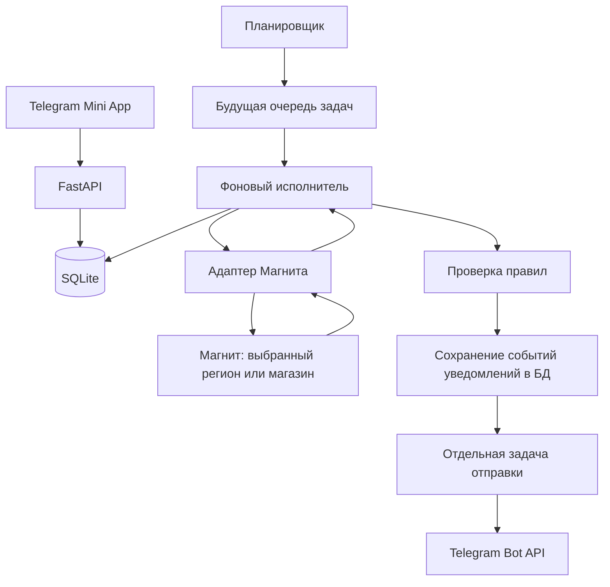

# Продукты Даром — контекст проекта для бэкенд-разработчика

Актуализировано 24 октября 2026 года по обсуждению проекта и локальному коду `saleapp`.

Репозиторий: [alihor123/freefood](https://github.com/alihor123/freefood).

Документ передаёт идею, принятые решения, текущее состояние и направление дальнейшей разработки. Разделы с будущей архитектурой описывают план, а не готовую реализацию. Содержимое удалённой ветки GitHub отдельно не сверялось.

## 1. Что делаем

**Продукты Даром** — Telegram Mini App для просмотра продуктовых товаров со скидками и уведомлений о подходящих предложениях.

Ближайшая версия работает **только с Магнитом**. Ранее обсуждались несколько сетей, но сейчас их подключение не входит в объём работ. Название приложения не означает бесплатную раздачу продуктов.

Пользователь сможет:

- просматривать каталог Магнита
- искать товары и применять фильтры
- открывать карточку товара
- отслеживать конкретный товар или категорию
- задавать условие «скидка от X%»
- получать уведомление от Telegram-бота, когда условие начинает выполняться

Пользователь выбирает товар из нашего каталога. Добавления и отслеживания товара по произвольной ссылке в текущей концепции нет.

## 2. Продуктовые решения и интерфейс

Основные вкладки: **Каталог · Отслеживание · Профиль**.

### Каталог

Карточка показывает название, изображение, текущую цену, цену до скидки, процент скидки, магазин и доступность. Вес, объём и бренд нужны продукту, но отдельных полей для них в текущей API-схеме пока нет.

Фильтры: категория, скидка от X%, цена от/до, наличие. В существующем контракте также сохранён `store_id`. Пока доступен только Магнит, выбирать между несколькими сетями пользователю не требуется.

Для скидки используется один минимальный порог, а не диапазон процентов. Поиск выполняется по нашей БД.

Карточка товара дополнительно показывает описание, время последней успешной проверки и кнопку отслеживания. Графика истории цен пока нет.

### Отслеживание

Правило относится к конкретному товару либо к категории Магнита. Пользователь задаёт минимальный процент скидки и может изменить порог, включить, выключить или удалить правило.

Примеры:

- «Этот шоколад в Магните, скидка от 30%»
- «Любые товары категории “Молочные продукты” в Магните, скидка от 40%»

Для категории проверяется каждый подходящий товар отдельно. Срабатывание по одному товару не должно блокировать уведомления о других товарах категории.

### Профиль и Telegram

Вход через Telegram, без email, пароля, ролей и системы разрешений. Отдельной вкладки уведомлений нет, сообщения приходят от бота.

В будущем в профиле возможны город и общий переключатель уведомлений. Сейчас `GET /api/auth/me` только возвращает данные пользователя, редактирования настроек профиля нет.

Самостоятельное Android-приложение на Kotlin и Jetpack Compose рассматривается как дальнейшее развитие. Его вход через Telegram потребует отдельного сценария привязки. Этот сценарий ещё не реализован.

### Что сейчас не входит в объём

Другие сети, объединение одинаковых товаров разных магазинов, графики, похожие товары, корзина, оплата, оформление заказов, отзывы, персональные программы лояльности и микросервисы.

## 3. Главный принцип работы бэкенда

Пользовательское API читает каталог из **нашей SQLite**, а отдельный фоновый процесс периодически получает данные Магнита и обновляет эту БД.

Поиск, фильтрация и открытие карточки не запускают запрос в Магнит. Объём обращений к источнику определяется расписанием и объёмом обновляемых данных. При выборочном обновлении это могут быть уникальные товары и категории из активных правил всех пользователей. Один и тот же товар не нужно получать повторно для каждого подписанного пользователя.

Один цикл обновления нужен и для каталога, и для проверки отслеживаний. Отдельный сборщик «на каждого пользователя» или «для каждой подписки» не нужен.

Будущий поток данных:



Сейчас реализованы HTTP-приложение и хранение пользователей и сессий. Товарная часть, очередь и показанный поток синхронизации ещё не работают.

## 4. Что уже есть в коде

| Компонент | Фактическое состояние |
| --- | --- |
| FastAPI, маршруты, Swagger | Есть |
| Проверка Telegram `initData` | Есть, проверяется подпись и настраиваемый срок давности |
| Создание пользователя и сессии | Есть |
| JWT access и refresh через AuthX | Есть |
| Ротация пары токенов, выход, отзыв сессии | Есть |
| Токены в JSON и HttpOnly cookies | Есть |
| CSRF для защищённых cookie-запросов | Есть |
| Очистка сессий | При старте и затем по расписанию |
| Каталог и отслеживания | Маршруты и Pydantic-схемы, бизнес-логика возвращает HTTP 501 |
| ORM-модели | Только `User` и `AuthSession` |
| Миграции Alembic | Есть начальная миграция пользователей и сессий |
| Адаптер Магнита | Отсутствует |
| Базовый адаптер и mock | Заготовки, рабочей выдачи товаров нет |
| Синхронизация каталога | Заготовка `sync_catalog()`, выбрасывает `NotImplementedError` |
| Очередь, Redis, отправка уведомлений | Не подключены |
| React-клиент и Android-клиент | В проверенной локальной копии ещё не реализованы |

Наличие маршрута в Swagger не означает, что соответствующая продуктовая функция уже работает. Неправильные параметры могут получать HTTP 422, а неавторизованный запрос к отслеживаниям — HTTP 401, ещё до исполнения заглушки.

## 5. Стек и причины выбора

| Технология | Зачем используется |
| --- | --- |
| Python 3.13+ | Читаемый код, быстрая разработка MVP, большая экосистема для API, БД и интеграций |
| FastAPI | Маршруты обычными функциями, асинхронный ввод-вывод, проверка данных через Pydantic, автоматические OpenAPI и Swagger |
| SQLAlchemy Async + aiosqlite | Асинхронный доступ к SQLite, ORM-модели и запросы отдельно от бизнес-логики |
| SQLite | MVP можно запустить без отдельного сервера БД, данные сохраняются в файле |
| Pydantic и Pydantic Settings | Схемы запросов и ответов, валидация и загрузка настроек из окружения |
| AuthX | Выпуск и проверка JWT, работа с auth cookies и CSRF |
| Alembic | Версионирование и воспроизводимое применение схемы БД |
| APScheduler | Сейчас запускает только периодическую очистку сессий |
| Uvicorn | ASGI-сервер для FastAPI |
| pytest, httpx, Ruff | Проверки поведения API и базовая проверка кода |
| React + TypeScript | Планируемый веб-клиент, компоненты и JSX, обновление интерфейса по состоянию, типизация данных API |
| Kotlin + Jetpack Compose | Возможный Android-клиент, корутины и декларативный интерфейс |
| Redis | Оставлен на будущее как брокер очереди фоновых задач |

Ранний концепт упоминал PostgreSQL, Celery и Celery Beat. После обсуждения выбрана SQLite, а конкретная библиотека очереди пока не утверждена. Эти ранние варианты не являются уже установленными компонентами.

SQLAlchemy помогает отделить запросы от приложения, но переход на PostgreSQL в будущем всё равно потребует миграций и проверки типов данных, SQL и конкурентного доступа. Это не обещание смены БД одной строкой без остальных проверок.

## 6. Структура и стиль кода

```text
backend/
├── app/
│   ├── main.py
│   ├── config.py
│   ├── dependencies.py
│   ├── routers/
│   │   ├── auth.py
│   │   ├── catalog.py
│   │   └── tracking.py
│   ├── schemas/
│   │   ├── auth_schemas.py
│   │   ├── catalog_schemas.py
│   │   └── tracking_schemas.py
│   ├── services/
│   │   ├── auth_service.py
│   │   ├── telegram_service.py
│   │   ├── token_service.py
│   │   ├── catalog_service.py
│   │   └── tracking_service.py
│   ├── database/
│   │   ├── database.py
│   │   ├── models.py
│   │   └── repositories/
│   │       ├── user_repo.py
│   │       └── session_repo.py
│   ├── adapters/
│   │   ├── base.py
│   │   └── mock.py
│   └── tasks/
│       ├── cleanup.py
│       └── catalog_sync.py
├── migrations/
├── tests/
├── .env.example
├── alembic.ini
├── pyproject.toml
└── uv.lock
```

Разделение ответственности:

- `routers` — HTTP-параметры, зависимости, коды ответа и описание Swagger
- `schemas` — внешние форматы данных и их проверка
- `services` — последовательность действий и бизнес-правила
- `database/repositories` — запросы к БД
- `adapters` — особенности получения и преобразования данных источника
- `tasks` — фоновые операции
- `dependencies.py` — получение текущего пользователя и общие зависимости
- `main.py` — сборка приложения, CORS и жизненный цикл

Ориентир по стилю — `kampus_back`: обычные понятные функции сервисов и репозиториев, короткие русские комментарии и docstring. Классы ORM и Pydantic естественны, но дополнительные сервисные иерархии, фабрики и универсальные обёртки сейчас не нужны.

`BaseAdapter` уже присутствует, но это небольшая заготовка, а не требование строить сложную систему наследования. Пока источник один, реализация Магнита должна оставаться простой.

Сохранять существующие комментарии и UTF-8. Настройки оставлять понятными, без дополнительных валидаторов и параметров «на всякий случай». В JS/TS не использовать точки с запятой. Изменения делать по согласованной задаче, коммиты — только по отдельному указанию владельца проекта.

## 7. Как устроена действующая авторизация

### Вход через Telegram

1. Mini App получает исходную строку `Telegram.WebApp.initData`.
2. Отправляет её в `POST /api/auth/telegram` как `{"init_data": "..."}`.
3. Бэкенд проверяет HMAC-подпись с токеном своего бота, структуру данных и `auth_date`.
4. Находит или создаёт `User` по проверенному `telegram_id`.
5. Создаёт новую `AuthSession` и выдаёт access и refresh.

Просто прислать Telegram ID или объект из `initDataUnsafe` для входа недостаточно. Каждый успешный вызов `/auth/telegram` создаёт новую сессию, но открытие приложения не обязано вызывать этот маршрут каждый раз.

### Обычный запуск клиента

1. Вызвать `GET /api/auth/me` с имеющимся access.
2. При HTTP 401 попытаться выполнить `/api/auth/refresh`.
3. При успешном refresh использовать новую пару и повторить исходный запрос.
4. Если refresh отсутствует или недействителен, выполнить вход с актуальными Telegram `initData`.

При нескольких одновременных HTTP 401 клиент должен координировать один refresh-запрос. Иначе несколько запросов попытаются обменять один одноразовый refresh, и часть получит HTTP 401.

### Ротация и таблица сессий

В `auth_sessions` хранятся:

- `id` — идентификатор сессии
- `user_id` — владелец
- `refresh_token_hash` — SHA-256 текущего refresh, сам токен не хранится
- `created_at` — дата создания сессии
- `expires_at` — дата истечения текущего refresh
- `revoked_at` — дата отзыва или `null`

При refresh AuthX проверяет подпись, тип и срок JWT. Затем БД атомарно заменяет хеш только при совпадении предъявленного refresh с текущим хешем неотозванной сессии.

Успешный обмен выдаёт **новый access и новый refresh**. Сессия остаётся той же строкой, её `created_at` не меняется, а `expires_at` становится сроком нового refresh. Старый refresh больше не принимается. Из двух конкурирующих обменов одного refresh успешно завершается только один.

По умолчанию access живёт 10 минут, refresh — 7 дней. При успешной ротации срок refresh начинается заново, фиксированного максимального возраста всей сессии пока нет.

Ротация refresh сама по себе не отзывает ранее выданный access. Он может работать до своего истечения, пока сессия существует и не отозвана.

### Выход и очистка

`POST /api/auth/logout` отзывает текущую сессию и удаляет auth и CSRF cookies. При следующих защищённых запросах проверяется запись сессии, поэтому отзыв действует и на уже выданные токены этой сессии. Другие сессии пользователя сохраняются.

Очистка выполняет один SQL `DELETE`, а не цикл по строкам в Python. Удаляются сессии с `expires_at <= сейчас` либо заполненным `revoked_at`. Задание запускается при старте приложения и затем раз в 24 часа по умолчанию. Дополнительного срока хранения отозванных записей нет.

Истёкший JWT отклоняется AuthX сразу. Ожидать фоновой очистки для отказа в авторизации не нужно. Если refresh истёк, обновить им себя уже нельзя — нужен новый вход.

### Cookies для веба и JSON для будущей мобилки

При входе и refresh сервер одновременно:

- возвращает в JSON `access_token`, `refresh_token`, `token_type`, `expires_in` и `user`
- устанавливает `access_token_cookie` и `refresh_token_cookie` с `HttpOnly`
- устанавливает доступные JS cookies `csrf_access_token` и `csrf_refresh_token`

Для веба используются cookies. При запросах с другого origin клиенту нужен `credentials: "include"`. JWT не требуется переносить в `localStorage`.

Для изменяющих cookie-запросов нужен `X-CSRF-TOKEN`. У refresh это значение `csrf_refresh_token`, у logout и будущих защищённых записывающих маршрутов — `csrf_access_token`. `GET /auth/me` не требует CSRF-заголовка.

Будущий мобильный клиент сможет отправлять access как `Authorization: Bearer ...`, а refresh — в JSON. Явный Bearer имеет приоритет над access cookie, JSON refresh — над refresh cookie.

В настройках есть `Secure` и `SameSite`, по умолчанию `Secure=true` и `SameSite=lax`. Для локального HTTP в примере окружения используется `Secure=false`. Схему доменов и поведение cookies в реальном Telegram-клиенте ещё нужно проверить при подключении фронтенда, текущая локальная конфигурация не заменяет эту проверку.

## 8. Текущий API-контракт

Общий префикс — **`/api`**, без `/v1`. Отдельного `/health` нет. Swagger доступен по `/docs`, OpenAPI — `/openapi.json`.

API-контракт описывает метод, адрес, параметры, тело, ответ, авторизацию и ошибки. Клиент может ориентироваться на него до завершения бизнес-логики. Планируемый ответ `200` в схеме не означает, что метод уже возвращает реальные товары.

| Метод | Маршрут | Доступ и состояние |
| --- | --- | --- |
| POST | `/api/auth/telegram` | Работает, вход по подписанным `initData` |
| POST | `/api/auth/refresh` | Работает, новая пара токенов |
| GET | `/api/auth/me` | Работает, access обязателен |
| POST | `/api/auth/logout` | Работает, access обязателен |
| GET | `/api/stores` | Публичный, пока 501 |
| GET | `/api/categories` | Публичный, пока 501 |
| GET | `/api/products` | Публичный, пока 501 |
| GET | `/api/products/{product_id}` | Публичный, пока 501 |
| GET | `/api/tracking` | Авторизация обязательна, пока 501 |
| POST | `/api/tracking` | Авторизация обязательна, пока 501 |
| GET | `/api/tracking/{tracking_id}` | Авторизация обязательна, пока 501 |
| PATCH | `/api/tracking/{tracking_id}` | Авторизация обязательна, пока 501 |
| DELETE | `/api/tracking/{tracking_id}` | Авторизация обязательна, пока 501 |

### Каталог

`GET /api/categories` принимает необязательный `store_id`.

Параметры `GET /api/products`:

| Параметр | Значение |
| --- | --- |
| `search` | Поиск по названию, от 1 до 200 символов |
| `store_id`, `category_id` | Положительные ID |
| `min_discount_percent` | Минимальная скидка от 0 до 100 |
| `min_price`, `max_price` | Неотрицательные границы текущей цены |
| `in_stock` | Необязательный фильтр наличия |
| `sort` | `discount_desc`, `price_asc`, `price_desc`, `recently_checked` |
| `page` | От 1, по умолчанию 1 |
| `page_size` | От 1 до 100, по умолчанию 20 |

Список товаров: `items`, `total`, `page`, `page_size`, `pages`.

Товар: `id`, `store_id`, `category_id`, `name`, `image_url`, `current_price`, `previous_price`, `discount_percent`, `in_stock`, `availability`, `last_checked`. Подробная карточка добавляет `description`.

Цены и проценты в схемах имеют тип `Decimal`. Формат JSON нужно учитывать на фронте: стандартная сериализация Pydantic для `Decimal` использует строки. Даты передаются в ISO 8601, смысл времени — UTC.

### Отслеживания

Пример тела создания правила, ID условные:

```json
{
  "store_id": 1,
  "product_id": 123,
  "min_discount_percent": "30",
  "is_active": true
}
```

Для категории вместо `product_id` передаётся `category_id`. Нужно ровно одно из этих двух полей.

`PATCH` разрешает менять `min_discount_percent` и `is_active`. Пустой запрос и явные `null` для этих полей отклоняются. Магазин и цель правила через PATCH не меняются.

Список отслеживаний содержит `items`, `total`, `page`, `page_size`. Успешные коды после реализации: создание — 201, удаление — 204, чтение и изменение — 200.

Проверка существования товара и его принадлежности магазину, SQL-операции и проверка владельца самого правила ещё предстоят. Описание этих гарантий в Swagger не является их реализацией. `user_id` для операций берётся из авторизации, а не из тела запроса.

## 9. Как планируется взаимодействовать с Магнитом

### Что пока известно, а что нужно исследовать

Предпочтительный вариант — разрешённый структурированный источник данных, если он доступен. JSON удобнее преобразовывать, чем HTML. Но точные адреса запросов, способ доступа, пагинация, ограничения и объём каталога **ещё не исследованы и не зафиксированы**.

Существование сайта и запросов его клиента не означает наличие официального публичного API для сторонних приложений. В этом проекте пока нет рабочего договора интеграции или проверенного `MagnitAdapter`.

Первый шаг — выбрать источник и проверить на небольшом объёме:

1. Как получить категории и товары для нужного региона или магазина.
2. Какие идентификаторы стабильны между обновлениями.
3. Как устроены страницы, курсоры и признак завершения выдачи.
4. Что означают текущая цена, цена до скидки и условия акции.
5. Доступны ли наличие, изображение, описание, вес и бренд.
6. Каковы ограничения доступа и допустимая частота запросов.

Начать с одного города и одного согласованного контекста источника. Не обходить все магазины России. Нужно отдельно выбрать, что показываем: предложения офлайн-точки, доставки или самовывоза, поскольку смешивать их цены нельзя.

На официальных страницах Магнита отмечается зависимость доступного онлайн-ассортимента от адреса доставки и магазина самовывоза. Это подтверждает необходимость определить контекст, но не доказывает, как устроены внутренние API.

### Роль адаптера

Будущий модуль `adapters/magnit.py` отвечает за запросы к источнику, пагинацию и преобразование полей к нашему формату. Он не отправляет сообщения пользователям и не знает об их правилах.

Ориентир нормализованного товара:

| Поле | Смысл |
| --- | --- |
| `external_id` | Стабильный ID товара в источнике |
| `store_id` | Наш ID сети или источника |
| Контекст региона/точки | Если нужен источнику, хранится отдельно от ID сети |
| Категория | Внешний ID и название с отображением на нашу категорию |
| `name`, `description`, `image_url` | Данные карточки |
| `current_price` | Текущая сопоставимая цена |
| `previous_price` | Цена до акции, если источник её предоставляет |
| `discount_percent` | Процент скидки, если его можно достоверно определить |
| `in_stock`, `availability` | Наличие и его пояснение |
| `source_url` | Необязательная ссылка на источник, не пользовательский способ добавления |

`previous_price` здесь означает цену до скидки. Это не обязательно цена, увиденная нами на предыдущем обходе.

Если процент рассчитывается по ценам, базовая формула: `(previous_price - current_price) / previous_price * 100`, при положительной прежней цене и сопоставимых условиях. Правило округления нужно закрепить и одинаково применять в фильтрах и уведомлениях.

Не выдавать кешбэк, персональную цену или скидку с особым способом оплаты за безусловную скидку для всех. Если надёжной базы для расчёта нет, процент остаётся неизвестным и правило по нему не срабатывает.

### Один цикл синхронизации

1. Планировщик создаёт задание на обновление выбранного контекста Магнита.
2. Фоновый исполнитель получает данные страницами или категориями, как позволяет источник.
3. Адаптер проверяет и нормализует ответы.
4. Сервис обновляет существующие товары и добавляет новые по устойчивому внешнему ключу.
5. Сохраняет время успешной проверки и при необходимости изменение цены в историю.
6. После успешного сохранения проверяет активные правила пользователя.
7. Создаёт события уведомлений и передаёт их отдельной отправке.

Примерная исходная идея — обновление раз в час. Это не установленный сейчас таймер. Реальный период, параллелизм и ограничения запросов выбираются после исследования источника и задаются конфигурацией.

Дополнительный вариант для рассмотрения — полный каталог обновлять реже, а товары и категории из отслеживаний чаще. Сценарий и ограничения этого варианта приведены в разделе 20, окончательный выбор ещё не сделан.

Планировщик не должен запускать второй одновременный обход того же контекста, если первый ещё не завершился. После подключения брокера этот контроль должен учитывать отдельные процессы, а не только `max_instances` внутри одного экземпляра APScheduler.

### Ошибки и полнота данных

При временном сбое сохраняется последний успешно полученный каталог. Ошибка не превращается в цену 0 и не означает, что все товары закончились.

Помечать пропавшие товары недоступными можно только после подтверждённого полного успешного обхода соответствующего каталога. Падение на второй странице не является основанием отключать товары с непрочитанных страниц.

Нужны ограниченные повторы временных ошибок с увеличивающейся задержкой, таймауты и ограничение частоты. HTTP 429 должен замедлять сбор, а постоянные ошибки доступа или формата — попадать в диагностику. Пользовательский API продолжает читать сохранённые данные.

## 10. Какие данные добавить в БД

Ниже направление модели, а не уже существующие таблицы или обязательные имена классов.

| Сущность | Назначение |
| --- | --- |
| `User` | Уже есть, Telegram-пользователь |
| `AuthSession` | Уже есть, текущий refresh и отзыв сессии |
| `Store` | Магнит как сеть или источник, его активность |
| `Category` | Категории выбранного источника |
| `StoreProduct` | Последнее известное состояние товара |
| `TrackingRule` | Владелец, товар или категория, порог скидки, активность |
| Состояние совпадения | Результат условия для пары «правило — товар» |
| `Notification` | Событие уведомления и состояние его отправки |
| `SyncRun` или `FetchJob` | Попытка обновления, статус, время, длительность и ошибка |
| `PricePoint` | История наблюдений цены, если нужна для требований следующих этапов |

Текущий товар хранится по устойчивой уникальной комбинации источника и внешнего ID. Если цена привязана к конкретной точке, её контекст входит в уникальность предложения или выделяется в отдельную сущность. До исследования Магнита точную схему этой части не фиксируем.

`TrackingRule` содержит владельца и ровно одну цель. Это правило стоит закрепить не только Pydantic-валидацией, но и ограничением БД при создании таблицы.

Деньги хранить без вычислений через двоичный `float`, с согласованным представлением, например целыми копейками. Время хранить и обрабатывать как UTC.

История цен и последнее состояние товара — разные данные. Для выдачи каталога не надо восстанавливать каждую карточку по полной истории. График в интерфейс добавлять не требуется, но исходное учебное ТЗ предусматривает сохранение истории цены, поэтому её объём для следующих этапов нужно учесть отдельно.

## 11. Уведомления и защита от дублей

После сохранения обновления проверяются включённые правила. Для товара совпадают магазин и товар, для категории — магазин и категория. Затем проверяется процент скидки и согласованное условие доступности.

Базовая логика — уведомлять при переходе «условие не выполнялось → условие выполняется»:

```text
Порог 30%

10% → 35%  отправить
35% → 36%  не отправлять
36% → 34%  не отправлять
34% → 20%  сбросить состояние совпадения
20% → 40%  отправить снова
```

Для категории состояние хранится по каждой паре `rule_id + product_id`, а не одним флагом на всю категорию. Повтор обработки одной задачи не создаёт новое событие для уже обработанного перехода.

Состояние перехода и запись `Notification` нужно сохранять согласованно в БД. У события должен быть устойчивый ключ уникальности, а у отправки — статус и число попыток. Ошибка Telegram не должна откатывать успешно обновлённый каталог.

Отправка выполняется отдельно. Если процесс упал между сохранением события и постановкой отправки в очередь, событие должно быть доступно для повторного подхвата из БД. Не полагаться только на задачу, которая существовала в памяти процесса.

Дедупликация в БД предотвращает создание повторных событий при повторном исполнении. При сетевом таймауте Telegram после фактической отправки остаётся неопределённость результата, поэтому абсолютную гарантию однократной доставки без отдельного механизма обещать нельзя.

Нужно ещё согласовать, уведомлять ли сразу при создании правила, если текущая скидка уже подходит, и как обрабатывать изменение порога или повторное включение. Простой вариант — одно уведомление при первом подходящем состоянии, затем обычная логика переходов. Это предложение, а не уже реализованное поведение.

В Mini App отдельная привязка Telegram ID сейчас не нужна, личность уже подтверждается при входе. Возможность бота писать пользователю надо проверить реальным сценарием запуска или разрешения сообщений. Если пользователь запретил сообщения, отправка должна учитывать это без бесконечных повторов. Для будущего самостоятельного мобильного клиента безопасную привязку проектируем отдельно.

## 12. Почему каталог хранится в SQLite, а не в Redis

Снимок каталога — последнее известное состояние товаров, которое переживает перезапуск и служит основой поиска, фильтров, правил и уведомлений.

В SQLite проще связать товары, категории, правила и события внешними ключами, применять индексы, ограничения уникальности и транзакции. При сбое Магнита приложение продолжит показывать сохранённые товары с временем последнего обновления.

Redis сейчас не требуется. Он оставлен для будущей очереди задач. Дополнительное кеширование запросов можно обсуждать при измеренной необходимости, но переносить в Redis основной каталог ради того, чтобы «куда-то его применить», не планируется.

При появлении отдельного worker учитывать ограничения SQLite: короткие транзакции записи, отсутствие лишних одновременно пишущих процессов и продуманное выполнение обновлений. Масштабирование до большого числа регионов или воркеров — отдельный этап, а не цель текущего MVP.

## 13. Очередь и планировщик

Планировщик решает **когда создать задачу**, очередь хранит **что нужно выполнить**, worker выполняет **саму работу**. Это разные обязанности.

Сейчас APScheduler запускает только очистку сессий внутри приложения. Полноценной очереди обновления каталога нет. Заготовка `tasks/catalog_sync.py` не запущена автоматически.

Когда начинается реализация фоновой синхронизации, нужно выбрать один механизм очереди и повторов. Redis может стать брокером для Celery, RQ или выбранного эквивалента, но сейчас ни один из этих вариантов не утверждён.

Для итогового учебного сценария нужны реальные фоновые задания, ограниченные retry с backoff, управляемая частота обращений и устойчивость к повторному исполнению. Обычный HTTP-обработчик не должен ждать обхода каталога. Чисто внутрипроцессная фоновая функция сама по себе не обеспечивает сохранность задания при перезапуске.

«Обслуживание очереди» здесь означает выполнение и учёт заданий, обработку ошибок, повторов и зависших попыток. Отдельную админку для этого пока не планировали.

## 14. Конфигурация и запуск текущего кода

Настройки читаются из `backend/.env`. В репозитории есть `.env.example`, реальные секреты в этот документ не включаются.

| Настройка | Значение по умолчанию в коде или смысл |
| --- | --- |
| `JWT_SECRET_KEY` | Обязательный секрет подписи JWT |
| `TELEGRAM_BOT_TOKEN` | Обязательный токен бота для проверки Telegram-данных |
| `JWT_ACCESS_TTL_MINUTES` | 10 |
| `JWT_REFRESH_TTL_DAYS` | 7 |
| `JWT_COOKIE_SECURE` | `true`, для локального HTTP в примере `false` |
| `JWT_COOKIE_SAMESITE` | `lax` |
| `TELEGRAM_CHECK_INIT_DATA_AGE` | `true` |
| `TELEGRAM_INIT_DATA_TTL_SECONDS` | 300 |
| `TELEGRAM_CLOCK_SKEW_SECONDS` | 30 |
| `DATABASE_NAME` | `freefood.db`, путь относительно `backend` |
| `SESSION_CLEANUP_ENABLED` | `true` |
| `SESSION_CLEANUP_INTERVAL_HOURS` | 24 |

`SESSION_RETENTION_HOURS` отсутствует и не нужен. `HOST`, `PORT`, `LOG_LEVEL` и список CORS origins не вынесены в `.env`, настройки запуска и CORS сейчас находятся в `main.py`.

После подготовки `.env` с секретами, из папки `backend`:

```powershell
uv sync
uv run alembic upgrade head
uv run python -m app.main
```

API: `http://127.0.0.1:8000`, Swagger: `http://127.0.0.1:8000/docs`.

При старте проверяется наличие таблиц пользователей и сессий. Приложение не создаёт недостающую схему автоматически вместо Alembic.

В `.gitignore` уже исключены `.env`, виртуальное окружение, локальные БД, кеши Python, логи и будущие `node_modules`. Файл `.env.example` разрешён для Git. Секреты передаются другому разработчику отдельно от контекста и исходников.

## 15. Проверки

В коде есть тесты авторизации и cookies: корректность Telegram-данных, истечение токенов, ротация, повторный и конкурентный refresh, независимые сессии, отзыв, очистка, HttpOnly, Secure, SameSite, CSRF и CORS.

Команды из `backend`:

```powershell
uv run pytest
uv run ruff check .
```

При составлении этого документа тесты заново не запускались, описан их существующий состав.

Для следующего этапа нужны проверки:

- импорт и повторный импорт одного товара не создают дубли
- поиск, фильтрация и пагинация работают по БД
- пользователь не читает и не меняет чужие правила
- частично неудачный обход не скрывает весь каталог
- переход через порог создаёт одно событие, неизменная скидка не спамит
- правило категории реагирует на разные товары независимо
- повтор задачи не создаёт повторное событие
- ошибка отправки не откатывает каталог
- весь сценарий воспроизводится на mock-источнике

Рабочий mock нужен для стабильной демонстрации и тестов, даже когда реальный источник только Магнит. Это технический источник, его не обязательно показывать пользователю как вторую торговую сеть. Текущий `MockAdapter` пока ничего не возвращает.

## 16. Предлагаемый порядок продолжения разработки

1. **Исследовать Магнит на маленьком примере.** Зафиксировать источник, контекст региона, поля, пагинацию и ограничения. Не обещать полный каталог до этой проверки.
2. **Добавить модели и миграции каталога.** Магнит, категории, товары и учёт попыток синхронизации. Параллельно сделать воспроизводимый mock.
3. **Реализовать чтение каталога из БД.** Заменить 501 в четырёх публичных маршрутах реальными сервисами, не меняя контракт без согласования с клиентом.
4. **Реализовать CRUD отслеживаний.** Владение, существование целей, принадлежность магазину, ограничения БД.
5. **Подключить фоновые обновления.** Выбрать очередь, добавить расписание, запрет перекрывающихся обходов, retry и ограничения запросов.
6. **Добавить проверку правил и Telegram-отправку.** Состояние переходов, события, защита от дублей и повторный подхват неотправленного.
7. **Собрать сквозную демонстрацию.** Вход → каталог → правило → изменение скидки → синхронизация → одно сообщение в Telegram.

Авторизацию переписывать для этого не требуется. Её нужно использовать для владельцев правил и будущих настроек пользователя.

## 17. Открытые вопросы и границы учебного задания

Перед реализацией соответствующей части надо решить:

- какой город и контекст Магнита берём первым, доставка, самовывоз или офлайн-магазин
- какой источник реально доступен и что он позволяет получить
- какая цена считается доступной обычному пользователю без персональных условий
- как округляем скидку и что делаем при неизвестной цене до акции
- какова допустимая частота синхронизации
- какой механизм очереди используем, когда он понадобится
- что происходит с первым уведомлением при создании, изменении или включении правила
- как пользователь разрешает сообщения бота и как открываем товар из уведомления
- требуется ли в ближайшем этапе общий переключатель уведомлений

В исходном учебном ТЗ были добавление по URL, абсолютный порог цены, история и график. В обсуждении продукта выбран каталог без добавления по URL, порог по проценту скидки и отсутствие графика на ближайшем этапе. История в БД при этом может понадобиться для приёмки следующих работ. Расхождения с буквальными критериями задания нужно согласовать с преподавателем, а не считать уже согласованными автоматически.

Для итогового проекта учебное ТЗ также предусматривает очередь, диагностику попыток, retry, ограничение нагрузки, защиту от дублей, реальный адаптер и mock, тесты, миграции и документацию. Первая версия с авторизацией и контрактами API — подготовительный этап.

## 18. Откуда собран контекст

- Обсуждение проекта с владельцем и его последнее уточнение: пока только Магнит.
- Локальные `README.md`, `backend/app`, миграция, `.env.example`, `pyproject.toml` и тесты проекта.
- Ранее переданный `PROJECT_CONTEXT.md`, с учётом последующих изменений решений.
- [Официальный сайт Магнита](https://magnit.ru/) — видимый каталог и предложения, без проверки внутренних API.
- [Страница акции Магнита с пояснением зависимости ассортимента от адреса и магазина](https://magnit.ru/udacha) — основание учитывать региональный контекст.

Главная договорённость: **Магнит обновляет нашу локальную копию через фоновые задачи, приложение читает эту копию, а уведомления формируются по изменениям относительно пользовательских правил. На сегодня готова авторизация, товарную часть предстоит реализовать.**

## 19. Предварительный алгоритм обработки и нагрузка на БД

Это предложение для реализации следующего этапа. Автоматических обработчиков записи в БД или готового механизма проверки правил в текущем коде нет.

### Правило и событие — разные записи

Пользователь создаёт **правило отслеживания**: например, товар 123, скидка от 30%.

При обновлении каталога сервис ищет подходящие активные правила. Если условие начинает выполняться, он создаёт **событие уведомления**, связанное с правилом, товаром и получателем. Отправка обрабатывает это событие отдельно.

Не нужно искать существующее событие товара, чтобы узнать, кому отправить сообщение. Получатели определяются по пользовательским правилам. Существующие события нужны для контроля отправки и защиты от дублей.

Правила ссылаются на внутренний `product_id` нашего каталога. Внешний ID Магнита используется адаптером, чтобы найти соответствующий товар в нашей БД.

### Пачка товаров вместо отдельных запросов на каждый товар

Пример процесса для полученной страницы из 100 товаров, число условное:

1. Одним запросом прочитать предыдущие состояния этих товаров по внешним ID и контексту источника.
2. В памяти сравнить данные и выделить изменения, влияющие на условие: скидку, доступность, категорию. Обновление названия или картинки само по себе не создаёт уведомление.
3. Для затронутых внутренних ID товаров и категорий старого и нового состояния пакетно получить активные правила. Практичный вариант — отдельная выборка правил товаров и отдельная выборка правил категорий.
4. Сгруппировать загруженные правила по товару и категории в памяти. При проверке каждого товара использовать эти группы без дополнительного SQL-запроса на каждое правило или пользователя.
5. Проверить переход условия. Изменение скидки 35% → 36% для порога 30% не является новым срабатыванием. Изменение 10% → 35% является.
6. Согласованно сохранить товарные обновления, изменения состояния совпадения и новые события уведомлений в короткой транзакции для пачки. Данные карточки и время проверки обновляются и тогда, когда уведомлять некого.
7. После успешного сохранения передать события отдельной отправке. Сохранённые, но ещё не отправленные события должны подхватываться повторно после сбоя процесса.

Проверка вызывается явно сервисом синхронизации. Для MVP не нужны триггеры SQLite или скрытая бизнес-логика в обработчиках SQLAlchemy на каждую запись.

Для простого изменения только процента переход можно выразить как `old_discount < threshold <= new_discount`. Общая проверка должна учитывать согласованную доступность и состояние пары «правило — товар», включая правила категории.

При создании правила, изменении порога или повторном включении нужна отдельная проверка текущего товара или категории согласно выбранной политике первого уведомления. Ожидать изменения цены для такой проверки не следует.

### Какие оптимизации достаточны на старте

- Уникальный индекс для поиска товара по источнику, внешнему ID и при необходимости торговой точке.
- Индексы для поиска правил по магазину и товару, а также по магазину и категории, с учётом активности правила.
- Индекс или первичный ключ состояния совпадения по паре `rule_id + product_id`.
- Уникальный ключ события уведомления, различающий отдельные срабатывания одного правила по одному товару.
- Пакетные чтения и записи, один commit на небольшую пачку вместо commit на каждый товар.
- Контролируемый размер пачки с учётом ограничений числа SQL-параметров и длительности транзакций SQLite.
- Один активный обход выбранного контекста источника, чтобы параллельные задачи не перезаписывали друг другу состояния.

Набор индексов окончательно выбирается под реальные SQL-запросы и проверяется планом выполнения. Индекс может ускорить поиск подходящих строк без полного обхода таблицы, но не устраняет работу по обработке найденных совпадений. [Документация SQLite о планировании запросов](https://www.sqlite.org/queryplanner.html).

Таким образом, нагрузка определяется размером полученной пачки, количеством значимых изменений и числом связанных правил. Полный перебор «все товары × все пользователи» не требуется. Если на одну категорию подписано много людей, обработка и отправка соответствующего числа уведомлений всё равно потребуют ресурсов, их можно выполнять пачками.

Для одного выбранного контекста Магнита это разумная исходная схема. Фактическую скорость нужно измерить на пробном каталоге и наборе правил, конкретные миллисекунды и допустимое число пользователей пока не измерялись.

## 20. Идея для рассмотрения: полный обход реже, отслеживаемое чаще

Это дополнительная идея владельца проекта для оптимизации. Она не является утверждённым расписанием или уже реализованным механизмом. Возможность такого обновления зависит от реальных запросов источника Магнита.

### Два вида обновления

**Полное обновление**, например раз в сутки, актуализирует весь выбранный каталог Магнита для нашего региона или точки. Оно обнаруживает новые товары и категории, обновляет предложения без подписок и позволяет учитывать исчезнувшие товары после полного успешного обхода.

**Выборочное обновление**, например раз в час, чаще проверяет интересующие пользователей товары и категории. Для этого сервис собирает объединённый набор целей из активных правил всех пользователей.

Если один шоколад отслеживают 100 пользователей, получаем его состояние один раз для данного контекста источника, а затем проверяем 100 правил по одним полученным данным.

При отслеживании категории нужно получать доступный ассортимент категории, включая новые товары. Проверка только ранее известных товаров пропустит новое подходящее предложение.

Если товар уже получен при обновлении категории, отдельно запрашивать его в том же цикле не требуется. Цели разных правил и пересекающихся категорий нужно объединять и устранять повторную обработку.

### Пример сценария

1. Полный обход загрузил каталог. У шоколада скидка 10%, данные доступны всем пользователям через наше API.
2. У первого пользователя есть правило на шоколад от 30%, у второго — от 40%. У третьего — правило на категорию сладостей от 25%.
3. Наступил следующий период выборочного обновления. Сервис получил обновлённую категорию, включая этот шоколад, со скидкой уже 35%. Дополнительный отдельный запрос шоколада не нужен.
4. Обработчик сравнил данные с нашей БД и пакетно выбрал активные правила на товар и его категорию.
5. Для первого и третьего пользователей условие впервые выполняется. Создаются два события уведомления. Для второго условие пока не выполняется.
6. Изменения и события сохраняются, отдельная отправка доставляет сообщения. Каталог нашего приложения также показывает новую цену шоколада.
7. При следующем получении тех же 35% повторных сообщений нет. Переход ниже порога и последующее новое достижение порога позволяют создать новое уведомление.

Проверяются значимые изменения и переход условия, а не просто факт изменения любого поля. Отправка относится к владельцу конкретного сработавшего правила, включая правило категории.

### Что проверить перед выбором этой схемы

- Позволяет ли источник запрашивать отдельные товары или категории и какие поля возвращает.
- Сколько запросов требует выборочная проверка по сравнению с полным обходом страниц. Много одиночных запросов может оказаться дороже нескольких крупных страниц каталога.
- Как объединять задания, если выборочное и полное обновления совпали по времени, чтобы они не дублировали и не перезаписывали друг друга.
- Устраивает ли продукт свежесть остальных товаров: при полном обходе раз в сутки предложения без подписок могут оставаться устаревшими почти сутки плюс время обработки. `last_checked` отражает реальную успешную проверку каждого товара.
- Нужно ли при создании нового правила ставить отдельное фоновое обновление его цели, чтобы быстрее проверить данные после редкого полного обхода. HTTP-запрос создания правила при этом не ждёт ответа Магнита.

При частичной проверке нельзя помечать весь остальной каталог отсутствующим. Сбой проверки также не означает отсутствие товара. Полное и выборочное обновления используют один адаптер, общий сервис сохранения и общий механизм проверки правил.

Решение после исследования источника может быть простым полным обходом, этой комбинированной схемой либо обновлением изменений, если источник предоставляет такую возможность. Примерные интервалы из этого раздела нужны для обсуждения, их нельзя считать подтверждёнными требованиями.
